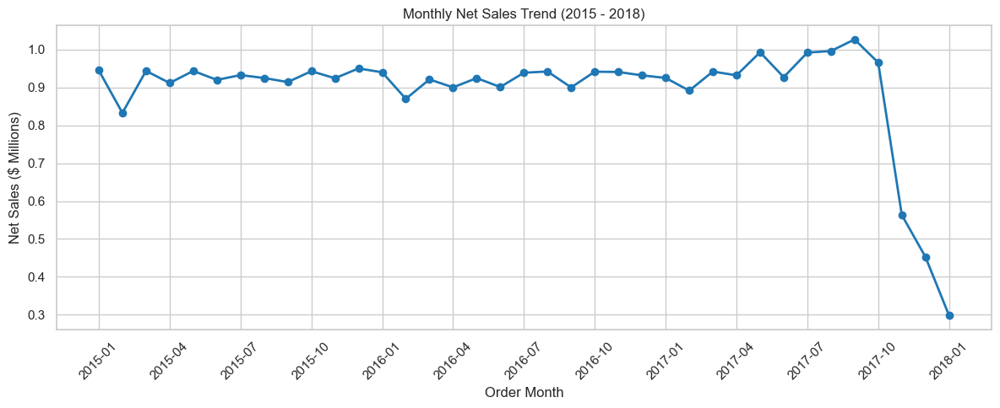
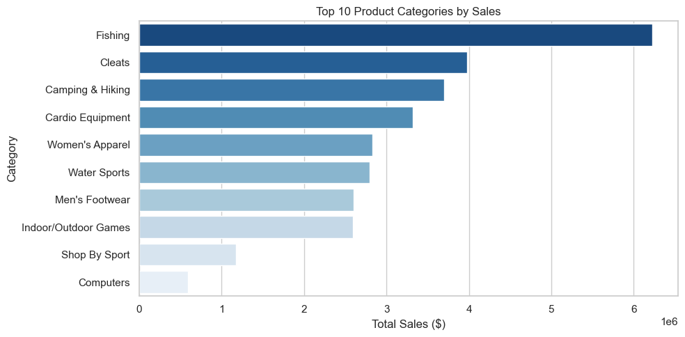
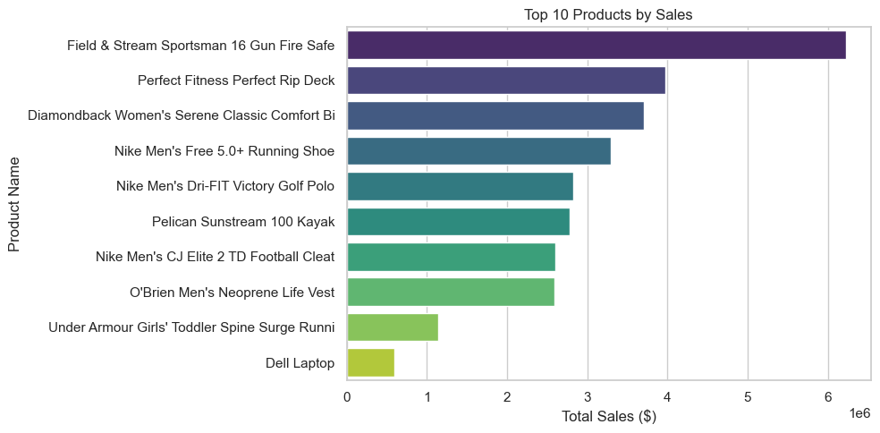
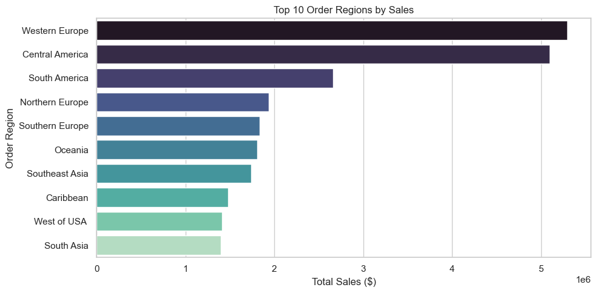
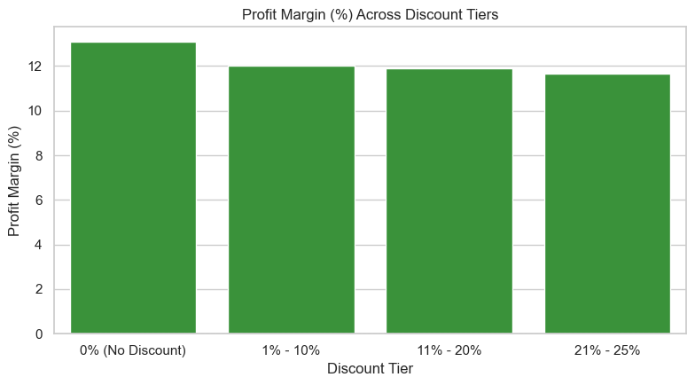
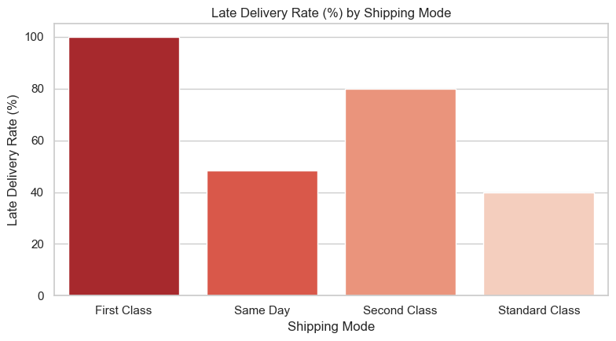
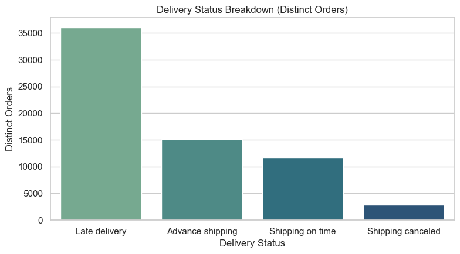

# Supply Chain Market Analysis

An end-to-end market analysis of DataCo Global order transactions. The project
uses Python EDA, SQL, and business visualization to explain revenue performance,
product demand, regional markets, discount profitability, and delivery experience.


## Business Problem

Management needs a clear view of where the business is growing, which products and
markets drive sales, and which commercial decisions reduce profitability or customer
experience.

The market analysis answers:

- Is monthly demand stable enough for planning?
- Which product categories and individual products drive revenue?
- Which geographic markets generate the strongest sales?
- Are large discounts producing profitable growth?
- Which shipping options fail to meet customer expectations?
- How large is the cancellation and delivery-status problem?

The central question is:

> Which markets, products, pricing decisions, and fulfillment priorities should the
> company focus on to protect revenue and improve commercial performance?

## Repository Structure

```text
D:\supply_chain\
|-- assets\
|   |-- 01-monthly-sales-trend.png
|   |-- 02-category-sales.png
|   |-- 03-top-products.png
|   |-- 04-regional-sales.png
|   |-- 05-discount-margin.png
|   |-- 06-shipping-mode-late-rate.png
|   `-- 07-delivery-status-breakdown.png
|-- data\
|   `-- order_lines_extended.csv
|-- notebooks\
|   `-- eda_supply_chain.ipynb
|-- sql\
|   |-- mysql_analysis_queries.sql
|   `-- mysql_schema.sql
|-- business_insights_report.html
|-- README.md
|-- requirements.txt
`-- .gitignore
```

## Analysis Scope

This README is intentionally focused on **market analysis**. The project dataset and
supporting report remain in the repository because they are required to reproduce the
analysis, but there is no separate dataset documentation section or report-style
chapter here.

The analysis uses:

- 180,519 order-line transactions
- 65,752 distinct orders
- 118 catalog products
- Order dates from 2015 through January 2018
- Sales, profit, discounts, categories, products, regions, shipping modes, and
  delivery statuses

Order-level delivery measures are calculated using distinct `order_id` values so
multi-item orders are not counted more than once.

## Tools

- **Python and Pandas:** Data preparation and aggregation
- **Matplotlib and Seaborn:** EDA charts
- **MySQL 8.0:** Market-analysis queries
- **Jupyter Notebook:** Reproducible analysis sequence

## EDA Market Analysis

The following seven charts are exported from the notebook and shown in the exact EDA
sequence.

### 1. Monthly Net Sales Trend



**Analysis**

- Net sales remain broadly stable at approximately **$0.8M-$1.1M per month** from
  2015 through 2017.
- The final January 2018 movement should be treated as the boundary of the supplied
  history rather than a confirmed business collapse.
- Stable demand provides a useful baseline for inventory, staffing, and fulfillment
  planning.

**Market implication:** The company can plan around a predictable revenue base while
using category, product, and regional analysis to decide where capacity should be
allocated.

### 2. Top Product Categories by Sales



**Analysis**

- Fishing, Cleats, and Camping & Hiking are the leading revenue categories.
- These three categories contribute approximately **46.8% of total revenue**.
- Category concentration means a small number of commercial areas have an outsized
  effect on total sales.

**Market implication:** Protect availability and supplier coverage in the leading
categories first. Category growth plans should be paired with margin and stockout
monitoring rather than sales volume alone.

### 3. Top Products by Sales



**Analysis**

- Revenue is concentrated in a small group of products.
- The **Field & Stream Sportsman 16 Gun Fire Safe** is the highest-revenue product,
  contributing approximately **$6.93M**, or **21.0% of total net sales**.
- The top 10 products generate more than **60% of company revenue**.

**Market implication:** Treat these products as priority products. They require
separate availability tracking, safety-stock decisions, supplier contingency plans,
and careful pricing management.

### 4. Top Order Regions by Sales



**Analysis**

- Western Europe, Central America, and South America are the leading regions by sales
  volume.
- Regional sales should be evaluated alongside profit, cancellation, and delivery
  performance.
- A high-sales region is not necessarily the most valuable region if fulfillment
  delays or discounting reduce its contribution.

**Market implication:** Use regional scorecards to guide inventory placement,
warehouse capacity, campaign investment, and carrier reviews. The next step is to
compare each region's sales with its margin and service level.

### 5. Profit Margin Across Discount Tiers



**Analysis**

- 0% discount: approximately **$7.47M** sales and **13.63%** margin.
- 1%-10% discount: approximately **$10.87M** sales and **13.78%** margin.
- 11%-20% discount: approximately **$11.27M** sales and **13.88%** margin.
- 21%-25% discount: approximately **$3.45M** sales and **-1.89%** margin.
- The 21%-25% tier produces an estimated **$65,230.74 net loss**, with **52.29%**
  of lines losing money.

**Market implication:** Deep discounting is not automatically profitable growth.
Standard promotions should be capped around 15%, while discounts above that level
should require approval and incremental-revenue evidence.

### 6. Late Delivery Rate by Shipping Mode



**Analysis**

- Completed orders are used as the denominator, while shipping-canceled orders are
  excluded from completed-shipment SLA calculations.
- First Class has the most serious service problem, with the notebook analysis
  reporting a **91.56% late-delivery rate** against its one-day schedule.
- Second Class is also substantially late, while Standard Class has the lowest late
  rate among the principal shipping modes at approximately **38.07%**.

**Market implication:** Premium shipping promises are not aligned with operational
performance. Recalibrate customer-facing delivery promises, review carrier and
warehouse bottlenecks, and monitor on-time delivery by region.

### 7. Delivery Status Breakdown



**Analysis**

- The order-level view separates late, advance, on-time, and canceled shipments.
- The project identifies **2,879 canceled orders**, represented by **7,754
  order-line records**.
- Delivery status must be analyzed at distinct order grain to avoid overstating
  cancellations or late deliveries for multi-item orders.

**Market implication:** Cancellations are both an operational and commercial
problem. They reduce realized customer value and can distort delivery metrics if
they are mixed with completed shipments.

## Anomaly Finding

The analysis finds **4,423 records** where actual shipping time is greater than the
scheduled time while `late_delivery_risk = 0`. All 4,423 records have
`delivery_status = 'Shipping canceled'`.

This is not a completed order that was incorrectly treated as on time. It is a
canceled shipment whose transit was not completed, which explains the apparent
conflict between shipping duration and the risk flag.

## Market Findings

1. **Stable demand:** Monthly revenue is predictable enough to support baseline
   planning.
2. **Category concentration:** Fishing, Cleats, and Camping & Hiking account for
   nearly half of total revenue.
3. **Product dependency:** The top 10 products account for more than 60% of sales.
4. **Regional opportunity:** Western Europe, Central America, and South America are
   the strongest regional markets by sales.
5. **Discount risk:** Discounts above 20% move aggregate margin into negative
   territory.
6. **Service risk:** Expedited shipping modes have severe late-delivery exposure.
7. **Cancellation leakage:** Canceled orders require separate operational tracking
   and should not be included in completed-delivery SLA denominators.

## Recommended Market Actions

| Priority | Recommended action | Reason |
| --- | --- | --- |
| 1 | Protect the leading categories and top 10 products | Revenue is highly concentrated |
| 2 | Create regional scorecards | Sales must be compared with margin and service |
| 3 | Cap routine discounts at 15% | Deep discounts destroy contribution margin |
| 4 | Recalibrate premium shipping promises | First Class misses its one-day schedule frequently |
| 5 | Reduce cancellations with 24-hour dispatch alerts | Cancellations reduce realized revenue and customer trust |
| 6 | Review pricing and inventory together | High-demand products need availability without uncontrolled markdowns |

## SQL Market Analysis

[`sql/mysql_analysis_queries.sql`](sql/mysql_analysis_queries.sql) contains eight
MySQL 8.0 queries. Each query answers a business question and supports a specific
part of the EDA:

| # | Business question | Answer produced by the query | How it supports the EDA |
| --- | --- | --- | --- |
| 1 | What are the total sales, profit, orders, and products? | Returns the overall baseline, including net sales, profit, distinct orders, and product count. | Provides the headline figures for the size and profitability of the business. |
| 2 | How do sales and profit change month by month? | Returns monthly sales, profit, order volume, and month-over-month changes. | Confirms the monthly sales chart and the stable revenue pattern. |
| 3 | Which product categories generate the most sales and profit? | Ranks categories by sales and reports units, orders, revenue share, profit, and margin. | Supports the finding that Fishing, Cleats, and Camping & Hiking are leading categories. |
| 4 | Which products contribute the most revenue? | Returns the top 10 products with sales, units, orders, revenue share, profit, and margin. | Confirms product concentration and identifies high-value products. |
| 5 | Which markets and regions perform best? | Compares regional sales, orders, units, revenue share, profit, and margin. | Supports the regional sales chart and geographic market comparison. |
| 6 | How are discounts related to profitability? | Compares discount tiers by sales, profit, margin, average economics, and loss-making lines. | Confirms that the highest discount tier produces negative margins and more loss-making transactions. |
| 7 | Which shipping modes have the highest late-delivery rates? | Returns total, completed, late, and canceled orders, plus late rates and schedule variance. | Validates the shipping-mode chart and highlights weak premium-delivery performance. |
| 8 | How many shipments were canceled, and what explains the shipping exceptions? | Returns cancellation rates and identifies records that exceeded the schedule without a late-risk flag. | Supports the delivery-status chart and explains that the apparent anomalies are canceled shipments. |

The SQL analysis uses distinct orders for delivery metrics so multi-item orders are
not counted more than once.
